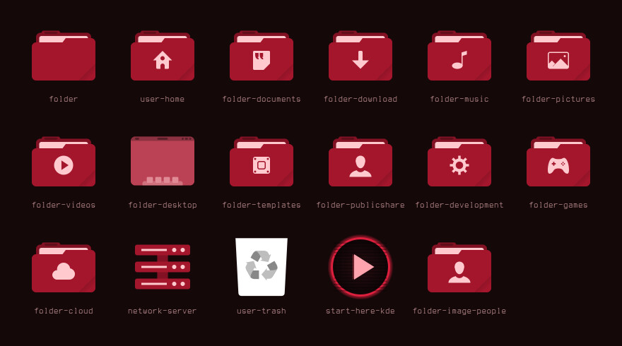
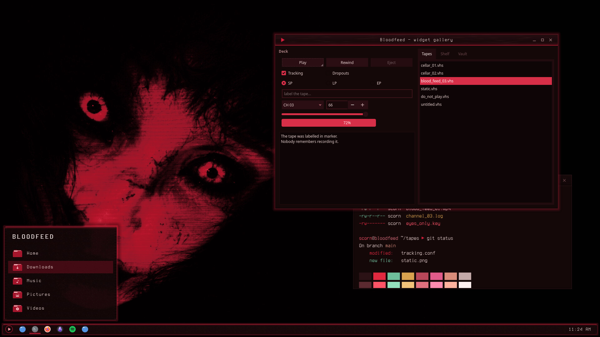

# Bloodfeed — Icons

Crimson folder and places icons plus a VHS-play launcher icon, layered over Tela circle dark.



Bloodfeed is a blood-dubbed VHS look for KDE Plasma 6, built around a crimson-lit face on near-black: blood-black surfaces, faint scanlines and tape grain, and a slight crimson glow on whatever has focus.

## Features

- Every folder and places icon (home, downloads, music, git, trash and the rest) recoloured to a deep crimson with pale-pink glyphs.
- A VHS `▶ PLAY` app-launcher icon: a scanlined blood-black disc with a crimson ring and glow, used for all `start-here` and `distributor-logo` names, symbolic ones included.
- All other icons are inherited from **Tela circle dark**, then breeze-dark.



## Requirements

[Tela circle icon theme](https://github.com/vinceliuice/Tela-circle-icon-theme), dark variant (`Tela-circle-dark`), installed alongside.

## Install

```bash
git clone https://github.com/numbpill3d/bloodfeed-icons
cd bloodfeed-icons && ./install.sh
```

Or from the KDE Store: Extract to `~/.local/share/icons/` and pick **Bloodfeed** in System Settings → Colors & Themes → Icons. Install Tela-circle-dark first.

## The rest of the suite

| piece | repo |
|---|---|
| SDDM login | [bloodfeed-sddm](https://github.com/numbpill3d/bloodfeed-sddm) |
| Plymouth boot splash | [bloodfeed-plymouth](https://github.com/numbpill3d/bloodfeed-plymouth) |
| Global theme + splash screen | [bloodfeed-global](https://github.com/numbpill3d/bloodfeed-global) |
| Plasma style (panel, popups) | [bloodfeed-plasma](https://github.com/numbpill3d/bloodfeed-plasma) |
| Aurorae window decoration | [bloodfeed-aurorae](https://github.com/numbpill3d/bloodfeed-aurorae) |
| Colour scheme | [bloodfeed-colors](https://github.com/numbpill3d/bloodfeed-colors) |
| Kvantum widget style | [bloodfeed-kvantum](https://github.com/numbpill3d/bloodfeed-kvantum) |
| Konsole + kitty colours | [bloodfeed-konsole](https://github.com/numbpill3d/bloodfeed-konsole) |

Everything at once, with the generators: [bloodfeed](https://github.com/numbpill3d/bloodfeed).

## Tags

`bloodfeed` `kde` `plasma6` `dark` `vhs` `scanlines` `crimson` `red` `blood` `horror` `retro` `analog-horror` `glow` `icon-theme` `icons` `folders` `tela` `red-folders`

## Credits and licence

By splicer scorn (voidrane). GPL-3.0-or-later.
Folder artwork recoloured from Tela circle icon theme by Vince Liuice (GPL-3.0).
